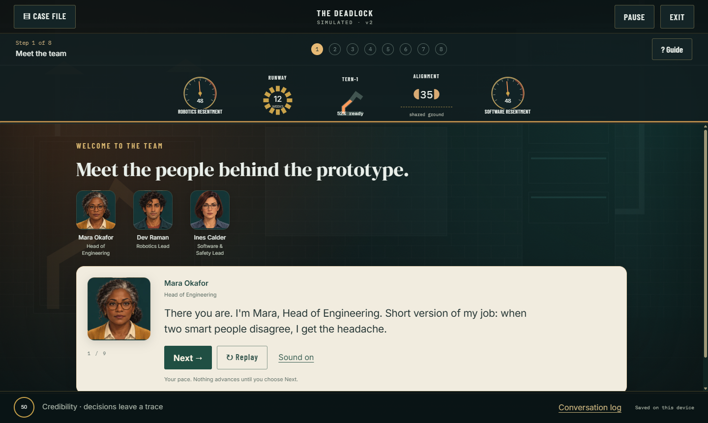
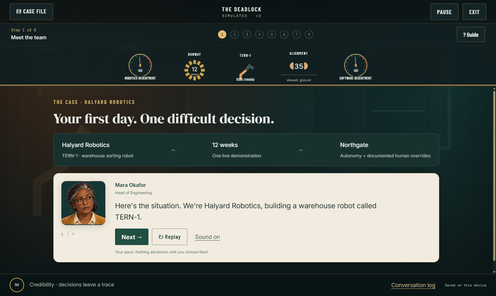
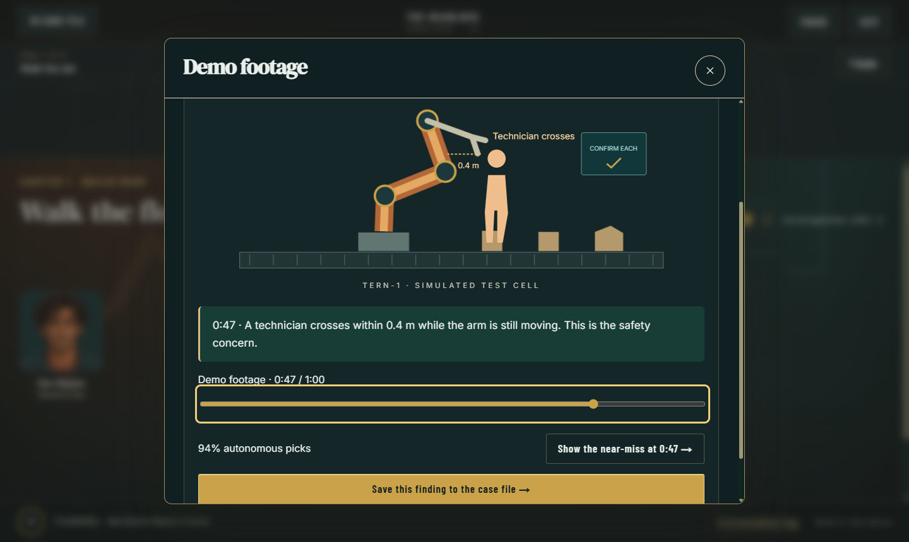
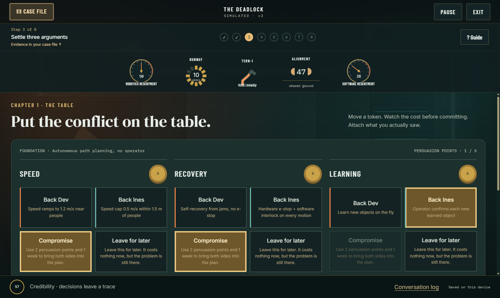
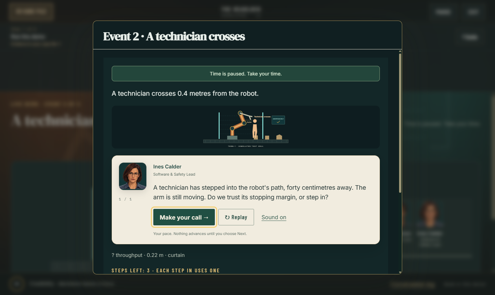
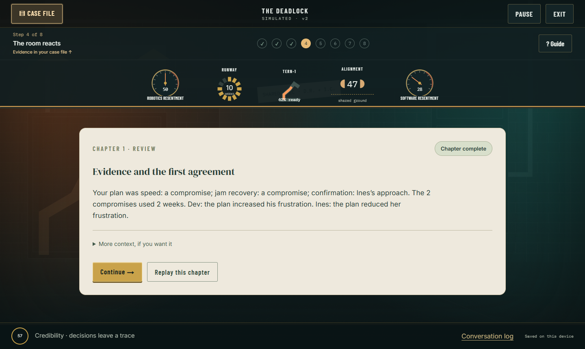
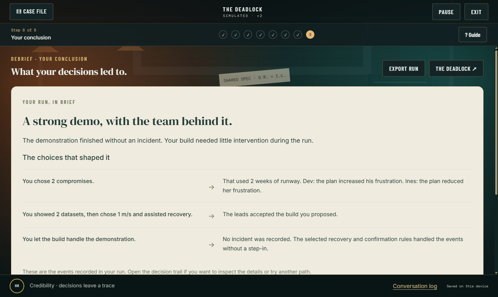

# Deadlock v2: the user journey

Production captures from the actual application, using a disposable guest profile and fictional case data. The default captions-only mode is shown; the full journey was also tested with recorded sound.

## Meet the team

## Understand the case

## Investigate an object

## Settle the arguments

## Make a live-demo decision

## Understand the chapter's consequences

## Read the conclusion

