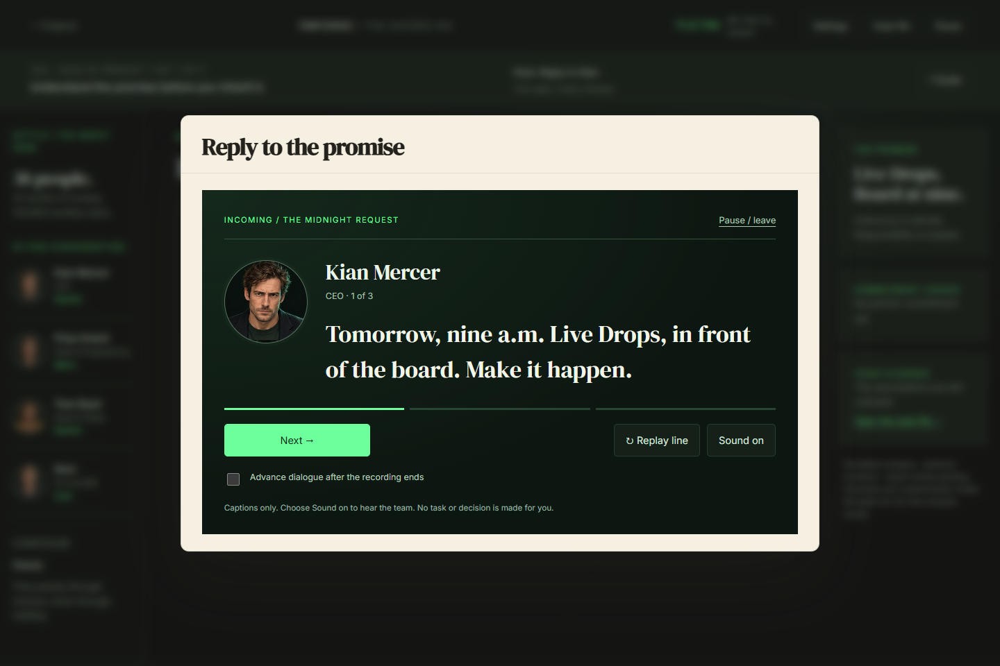
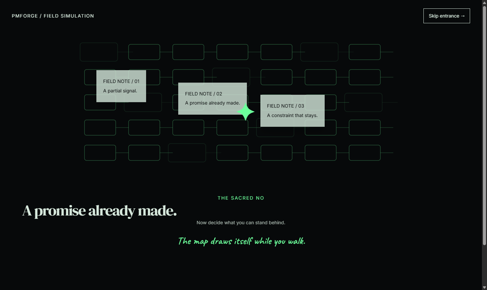

# The Sacred No — implemented experience

The dedicated simulation is at `/app/projects/sacred-no`. The whole project card opens it. Its entrance restores the original paper / pin / connected-grid animation, with immediate Skip and a calm alternative. The entry offers saved runs and explicit Sound + captions / Captions only choices. Open the message begins a sequential character conversation. Existing generic Sacred No runs remain in their legacy routes; this implementation does not overwrite them or their decisions.

## The player journey

1. **The midnight message.** Kian needs a live-shopping demonstration for the 9 AM board. Reply immediately with On it / Walk me through what you promised / Call me. Priya needs a safe queue; Tess needs a partner promise. A short role card explains your authority and Kian's ability to overrule it. The three short lines are sequential and end in the actual reply buttons, rather than a reading wall.
2. **Triage.** Five claims form the CEO's plan. Investigate load tests, the prior incident, payment limits, the checkout dashboard or support/review comments. The visible 110-minute research allowance permits three or four sources, not all five. Select-and-click, drag-and-drop and native keyboard buttons all connect evidence to claims. Relevant contradiction breaks a strand; customer demand can support one. An irrelevant connection is labelled rather than silently accepted.
3. **Allocate engineering.** Divide ten hours between safeguards and feature work. Capacity updates immediately. At least two feature hours are required for a production demonstration; allocating everything to safeguards is not a free optimum. Payment capacity remains a separate limit.
4. **Rehearse.** Try up to three argument types, fifteen story minutes each. Kian's replies reveal his lens. This is labelled rehearsal, not a real promise. Skip directly to the call if desired.
5. **Compose the call.** A guided composer presents one question at a time: position, up to two collected sources, alternative, request, deadline, then tone and review. Priya gives a short recorded cue for each part. These choices produce an exact sentence. Direct / Warm / Hedged tone changes its phrasing. A directional preview signals gaps without pretending to predict an exact verdict. Confirm the complete sentence before committing. A weak hedged refusal can be received as an unguarded Yes; a relevant No with an alternative can steady the room.
6. **Morning callback.** Priya responds to the call you actually made. A full commitment or reduced engineering trust caps safeguard hours at five. An evidence-backed approach can earn a kill switch. Explicit queue isolation and a rollback owner protect more of the system, at the cost of feature work. The original call is available as a linked receipt.
7. **Trade with Tess.** Inspect each commitment's upside, cost and release obligation before accepting. Choose up to two or refuse every deal. Incompatible public-delay and live-production promises cannot coexist. Credits are a recorded $12,000 debt. An accepted production promise cannot be erased by a later slide. A back-channel route makes the negotiation more costly in trust.
8. **Choose the blast radius.** Six disjoint cohort controls show who is exposed. A single lazily loaded Three.js Points object visualizes the selected sample, with 12,000 desktop / 3,000 initially mobile points. DPR is capped at 1.5. It renders on changes, pauses off-screen/in hidden tabs, disposes its resources, and preserves an SVG fallback. Controls and labelled load/payment figures carry all decision information.
9. **Lock the board proposal.** Cite collected evidence, review the proposal, audience, partner obligations, capacity and payment forecast together, then lock. If you deliberately skipped all research, an explicit uninformed handoff remains available rather than stranding the run.
10. **The board.** The room shifts from green-black to cream and silver. The actual locked plan is demonstrated or presented. A live route shows an authored traffic ramp, not real telemetry. Capacity, payment limits, safeguards and the Marlo-only promise determine stable, contained/degraded, full failure or named partial failure. An unfinished feature postpones the demonstration. A strong checkout alternative can receive a rare golden acknowledgement; its target remains a forecast, never an invented measured conversion lift.
11. **The final response.** Own the result, defend it with a reversal condition, or propose rollback. Established credibility unlocks a request for one week. The verdict is Backed, Tolerated, Overruled, Crash or Standoff, with an authored behavioral pattern, not a personal competency score.
12. **Brief conclusion first.** One result and up to three short choice-to-consequence rows. Exact call wording stays in its receipt. Detailed trace, seven recent major moments, missed signals, exact variables, original/branch comparison and three authored hindsight previews are optional. Replay branches before a selected event and preserves the original. Reflection is optional; export remains available.

## What carries over from Deadlock

- Clear role, current goal, next action and visible cost; shorter contextual guides with a persistent opt-out.
- Distinct readable static portraits, with no mouth or eye animation.
- Short human dialogue, contextual questions, clear spoken measurements and complete captions.
- Explicit confirmation before important commitments.
- Highlighted Case file, readable evidence and receipts connecting choices to results.
- Sequential foreground conversations after meaningful choices, rather than passive footer replies. Sound-enabled conversations play their current recording automatically. Next / Replay / Mute remain explicit. Optional auto-advance requires the real audio ended callback and cannot choose a reply or task. Pausing preserves the current line.
- Pause, resume recap, local autosave after decisions, owner isolation, stale-tab conflict checks, export and immutable replay forks.
- Responsive tap/keyboard alternatives, reduced motion, calm effects and optional larger text.
- A short conclusion, with detail available on request.

## Rules and deliberate interpretations

The handoff's numbers are starting values, not calibrated predictions. `src/lib/sacred-no/engine.ts` is a deterministic reducer; exports contain versioned events rather than an untrusted stored score. Receipts retain their exact words and event index. Fuses reference real earlier receipts and fire at their target scene. No live LLM decides outcomes.

Several handoff tensions were resolved explicitly:

- Deal liabilities are **discoverable before acceptance**, rather than hidden until after it, to satisfy the no-gotchas rule.
- Overnight research has a visible 110-minute budget; later reading never consumes wall time. Long research/rehearsal shortens the morning. No reflex timers or forced reading deadlines.
- Back-channel eligibility uses CEO trust below 45, and the constrained morning uses engineering trust below 50 or an unguarded launch. The supplied 35/40 chapter-one thresholds were not reachable from the supplied initial values and single-call changes. These reachable prototype thresholds need playtesting.
- Strength of four requires relevant risk evidence. Demand comments alone cannot justify a refusal. Explicitly testing a relevant claim adds credibility.
- Payment attempts are modelled as 20% of concurrent viewers per minute; this is a visible assumption, not a conversion of an external provider's real limits.
- The checkout deck's 2.8s → 2.6s / approximately 7% target is a **planning forecast**. A golden acknowledgement rewards a testable alternative, not a fabricated measured result.
- The cave sequence animates the local scene, not GSAP's global timeline, preserving other app motion and audio timing. Portraits stay still in line with the latest user feedback. Heavy ambient WebGL and continuous vibration are omitted; short pressure movement and major consequence effects carry the tension.
- The 3D field has its own canvas only in the immersive rollout scene. The workspace canvas is not mounted there. It uses change-driven rendering rather than a permanent frame loop.

## Cast, recordings and provenance

The generated four-expression / five-person portrait atlas is `public/sacred-no/cast-v1.webp`. It was created with the built-in ImageGen tool; the final prompt is stored alongside it in `CAST-PROMPT.txt`. Rows are Kian, Priya, Tess, Lena, Noor; columns Neutral, Thinking, Annoyed, Approving. It remains readable in the small People rail. No person's likeness was cloned.

82 pre-rendered MP3s use the existing offline Kokoro-82M runtime. Priya uses Mara's approved `af_heart` voice family and pace (0.96); Kian `am_puck`, Tess `af_bella`, Lena `bf_emma`, Noor `af_sarah`. Each line is fourteen words or fewer. Emotion direction adjusts offline pace and pauses; the provider does not implement fully acted emotion tags. Nothing synthesizes speech in the browser. Recordings load individually and use signature-versioned URLs; missing/blocked playback leaves captions and controls available.

Reproduce with the bundled Python compatible with `.data/deadlock-voice-runtime`, the documented Deadlock model files, and `scripts/render-sacred-no-voices.py`. No weights or Python runtime are shipped. Model license is included. The short-utterance limitation is documented by the [model's primary voice guidance](https://huggingface.co/hexgrad/Kokoro-82M/blob/main/VOICES.md). The point field follows the [Three.js API](https://threejs.org/docs/).

## Verification and remaining launch work

`npm run test:sacred-no` covers 22 engine/content/conversation cases: the ten requested canonical paths, Marlo partial failure, containment, deterministic replay/receipts, script/asset coverage, invalid/contradictory choices and the all-safeguards build-time trade-off. `npm run build` runs the short-line/reference/recording linter before compiling. The existing product/account suite plus reset regressions passes 50 tests.

`node docs/verify-sacred-no.mjs` exercises the actual guest entry, evidence links, resource allocation, rehearsal, sentence confirmation, trade, rollout, board, two complete contrasting endings, resume, fork preservation, responsive layouts and produced recordings. `node scripts/sacred-no-budgets.mjs` records the production boundary and lazy coverage sizes. Reports and review captures are in `docs/sacred-no-verification`.

The conversation browser run verifies the restored entrance, captions-only manual progression, foreground response and task guides, pause preserving the same line, sound playback, auto-advance waiting for real audio completion, the six-part call, both complete endings, saved-run recovery, forks, narrow layouts, keyboard focus, failed audio, reduced motion and playback of all 82 recordings. The full run passed 51 checks with zero browser errors and played all 82 recordings. After the preference migration and final copy/layout changes, a 50-check smoke pass also succeeded. The final production boundary is 246,796 bytes gzip; lazy coverage/Three remains 180,979 bytes gzip. The 82 on-demand clips total 4,023,503 bytes. Exact reports and build identity are in the JSON reports.

## Conversation and task guide update

Every scene has a recorded guide and a plain next move in `content.json`. `conversations.ts` assembles at most three lines from the actual state and choice. Relevant / supportive / irrelevant evidence connections have distinct reactions; a crash cannot trigger a success speech, and Tess only references accepted commitments. The conversation owns playback, index and completion—there is no guessed-duration timer, typing animation or live LLM.

Closing a guide focuses and briefly outlines the actual task control. The Guide button reopens the current scene, or the current part of the call. Automatic guidance can be disabled without suppressing character consequences. Legacy preferences migrate to guided, manually advanced conversations once; subsequent choices are preserved. The detailed reading material remains in evidence cards, receipts and optional debrief disclosures.

Local analytics are bounded to 300 events per workspace and record scene transitions, evidence opening, call submission/outcome, commitment acceptance, demo result, spectacle, debrief/hindsight/replay, pause and exit. They stay on this device; they are not a configured production analytics backend.

Real 6–8-person think-aloud playtests, time-to-first-action measurement, felt-pressure/fairness surveys, expert calibration, physical Safari/iOS/Android, actual screen-reader validation and subjective voice casting remain unperformed. Automated checks cannot certify these. Forty minutes is an intended session length, not a measured guarantee. Project runs do not yet participate in account sync or general workspace backup; use the project's Export run action. Full offline availability of previously unvisited lazy assets is not guaranteed. This is an authored playable MVP, not launch certification.
